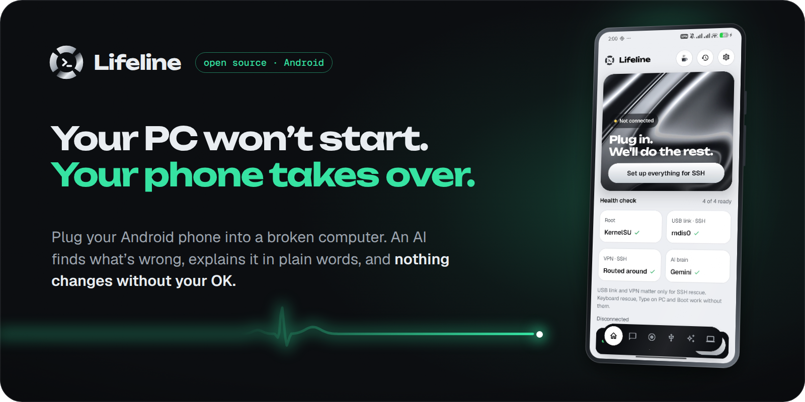
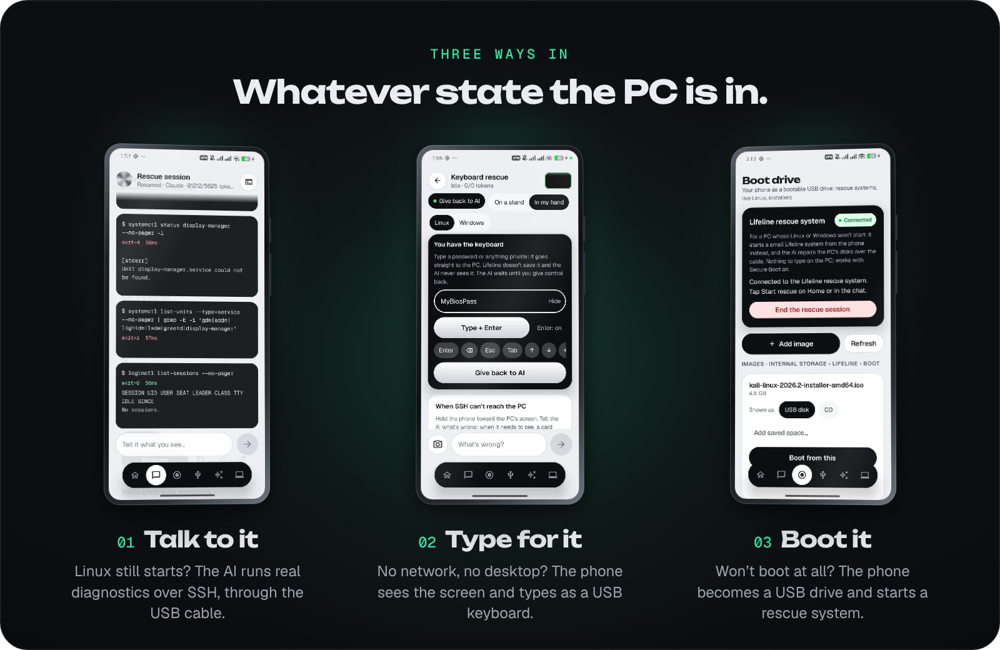
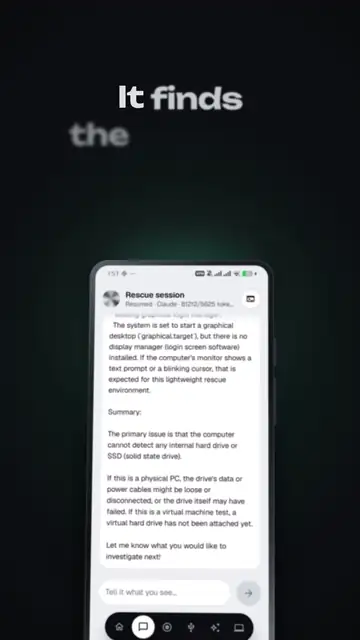

<p align="center">
  
</p>

<p align="center">
  <b>An AI repair kit for broken computers, on the phone in your pocket.</b><br>
  One USB cable. The AI you already pay for. Nothing changes without your OK.
</p>

<p align="center">
  <a href="https://github.com/techbysakh963/Lifeline/releases"></a>
  
  
  
</p>

<br>

<p align="center">
  
</p>

## Nothing changes without your OK



The AI looks first and touches nothing: read-only commands run on their own, everything else waits for you.

- **Every change is a card:** the evidence, the exact command, what it does and whether it can be undone.
- **Destructive steps** need you to type `DELETE`.
- **Never run:** disk formatting, partitioning, bootloader and firmware writes.
- **Verified after:** the AI checks that the fix worked and tells you in plain words.
- **No door left open:** *Remove from this laptop* takes the phone's key back and undoes only what Lifeline changed.

Every step goes into a conversation saved under that PC, so you can come back to it, copy it or share it.

<br clear="right">

## Bring your own AI

Sign in to the **Claude**, **ChatGPT** or **Gemini** subscription you already have. Their official command-line tools
run on the phone with your own account, and Lifeline never sees your password. Prefer an API key? Claude, OpenAI,
Gemini and DeepSeek work too.

## Get started

1. Install the APK from [Releases](https://github.com/techbysakh963/Lifeline/releases) and allow root access.
2. Pick an AI brain in the **AI** tab.
3. Plug the phone into the PC.
4. Choose how to get in: **Set up everything** (SSH), **Keyboard rescue**, or the **Boot** tab.

## What you need

- **A rooted Android 10+ phone** (KernelSU, Magisk or APatch) and a USB cable.
- **Keyboard rescue and Type on PC:** a phone kernel with USB keyboard (HID gadget) support. Lifeline checks this and
  hides these features if your kernel doesn't have it.
- **Boot tab:** a phone kernel that can act as a USB drive (mass-storage gadget). The rescue system boots on 64-bit PCs,
  with Secure Boot on or off.
- **SSH rescue:** a Linux PC. Keyboard rescue works with any PC: BIOS and boot menus, Linux consoles, Windows recovery.
- **An AI:** a Claude, ChatGPT or Gemini subscription, or an API key.

Lifeline is in **beta**.

<details>
<summary><b>How it works</b></summary>

```
 ┌──────────── phone (Lifeline) ────────────┐        USB cable         ┌──────── broken PC ────────┐
 │  AI brain ─► tool call ─► safety policy  │  SSH · USB keyboard ·    │  real commands, real logs │
 │      ▲                       │  approve? │  USB drive               │                           │
 │      └──── real output ◄─────┴───────────│ ◄──────────────────────► │  or: the screen, via the  │
 │            (or a camera photo)           │                          │  phone's camera           │
 └──────────────────────────────────────────┘                          └───────────────────────────┘
```

- **SSH over USB:** *Set up everything* turns on USB tethering, routes around your VPN, creates the phone's SSH key, and
  shows one line to paste on the PC (`curl -fsSL http://<phone>:8787/s/<token> | sudo sh`). That line enables OpenSSH,
  authorizes the phone and records what it changed, so *Remove* can undo exactly that.
- **Keyboard rescue:** for a black screen, a boot menu or Windows recovery. The phone is a USB keyboard (HID gadget),
  and the AI sees the screen through camera photos, with the phone in your hand or on a stand. Passwords go through
  **Take control**: you type them, and the AI never sees them.
- **Boot:** the phone shows up as a USB disk or CD with the image you pick, plus optional saved space the PC can write to.
  The Lifeline rescue system starts with Secure Boot on and connects back to the phone by itself.
- **Safety:** every command goes through `CommandPolicy`, an allow-list classifier: read-only, needs approval,
  destructive, or never. Command output is treated as untrusted data, and secrets are redacted before they reach the AI.

</details>

<details>
<summary><b>Build from source</b></summary>

Requires JDK 17+ and the Android SDK (platform 35, build-tools 35.0.0).

```bash
echo "sdk.dir=/path/to/android-sdk" > local.properties
./gradlew :app:testDebugUnitTest      # JVM tests (SSH, policy, agent, setup scripts, migrations…)
./gradlew :app:assembleDebug          # app/build/outputs/apk/debug/app-debug.apk
adb install -r app/build/outputs/apk/debug/app-debug.apk
```

On-device tests against a real OpenSSH server are in `app/src/androidTest`. The rescue
system is built by `rescue-image/build.sh`.

| Folder (`app/src/main/java/com/rodinrescue`) | What's inside |
|---|---|
| `ai/` | The AI brains (subscription CLIs and API providers), `Tools`, `DiagnosticAgent` (the loop) |
| `security/` | `CommandPolicy`, `Redactor` |
| `transport/` | `SshTransport` (sshj), `UsbNet` |
| `usb/` | USB keyboard, USB serial, boot drive, the rescue system |
| `vision/` | Camera photos and screen-settle detection for keyboard rescue |
| `setup/` | One-tap setup, the PC script, `LaptopCleanup` (Remove), AI CLI installer |
| `data/` | `SecretStore` (Android Keystore), settings, devices, conversations, audit log, migrations |
| `ui/` | The Frost design system, screens, splash, app lock |

The Android package id stays `com.rodinrescue` (the project's first name), so existing installs upgrade in place.

</details>

## ☕ Buy me a coffee

Lifeline is free and open source. If it brought your machine back, a coffee keeps it going.

<p align="center">
  
</p>

| Asset | Network | Address |
|---|---|---|
| **USDT** | **Ethereum (ERC-20)** | `0xfd64cbc4935dcce5b719e223469a84c83650b010` |

> Send **only USDT on Ethereum (ERC-20)** to this address. Other coins, NFTs or networks (TRC-20, BEP-20, …) can't be recovered.
> The same QR is in the app: the cup button on Home, or Settings → Buy me a coffee.

## License

Copyright 2026 **techbysakh963**. Licensed under the [Apache License 2.0](LICENSE).

You may use, modify and share Lifeline, **but every copy or derived work must keep the copyright notice and include the
[`NOTICE`](NOTICE) file crediting the original author** (for example in its About screen or README). The Lifeline name
and logo may not be used to promote a derived product.

## Credits

Fonts: [Geist & Geist Mono](https://github.com/vercel/geist-font) and [Unbounded](https://github.com/googlefonts/unbounded),
SIL Open Font License 1.1 (`third_party/fonts/`). SSH by [sshj](https://github.com/hierynomus/sshj), crypto by
[Bouncy Castle](https://www.bouncycastle.org/).
